# Hotpot: Beast Feast Cooking

A Foundry VTT module for running the **Beast Feast** campaign frame in [Daggerheart](https://www.daggerheart.com). It turns cooking into a shared, animated scene at the table. Throw ingredients into the pot, roll the flavor dice, collect matches and serve the Meal Rating to the party. It also adds a GM ingredient generator, Beast Feast equipment in character creation, a ready-to-use campaign map and a compendium of food-themed adversaries for Tiers 1–4.

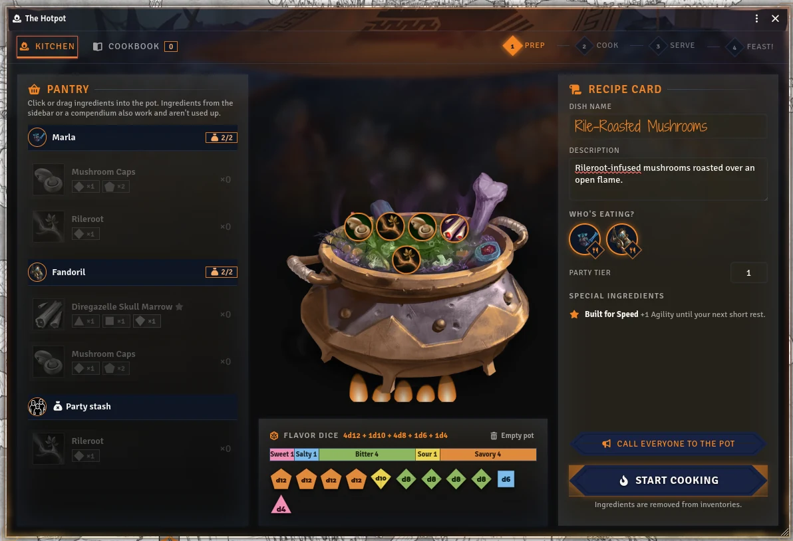

## Requirements

- [**Foundry VTT**](https://foundryvtt.com/) v14
- [**Daggerheart**](https://foundryborne.online/) system 2.12 or later
- [**Daggerheart Core Rulebook**](https://www.foundryvtt.store/products/daggerheart-core) module (`daggerheart-core`): provides the Beast Feast ingredient items, the ingredient generator tables, the campaign map and the art and theme the kitchen uses. Hotpot doesn't include any of that content itself.
- Optional: [**Dice So Nice**](https://foundryvtt.com/packages/dice-so-nice) for 3D flavor dice

## Installation

In Foundry's **Add-on Modules → Install Module**, paste this manifest URL:

```
https://github.com/emberite/dh-hotpot/releases/latest/download/module.json
```

## A meal from start to finish

| | |
|---|---|
| 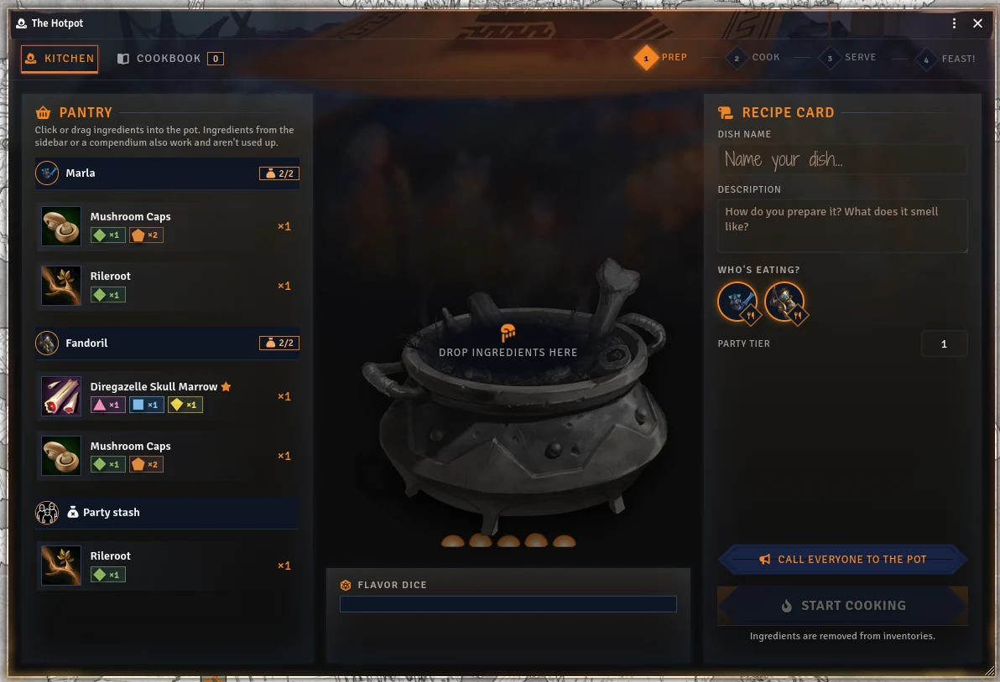 |  |
| **Prep:** the pantry lists what each character and the party stash carries. | Ingredients bob in the pot while the flavor dice and profile build up. Name the dish and pick the diners. |
| 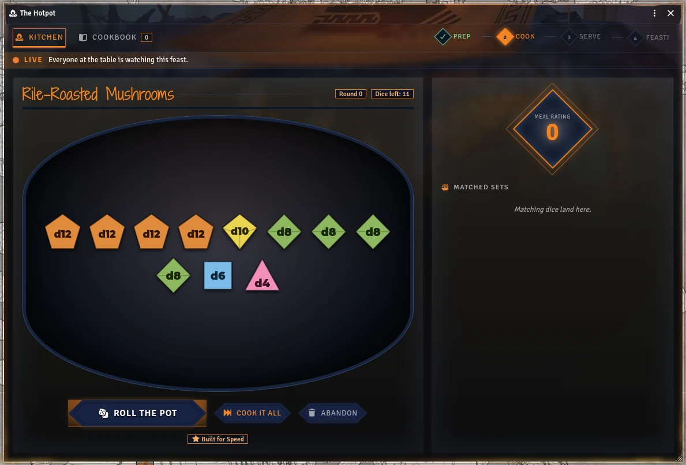 | 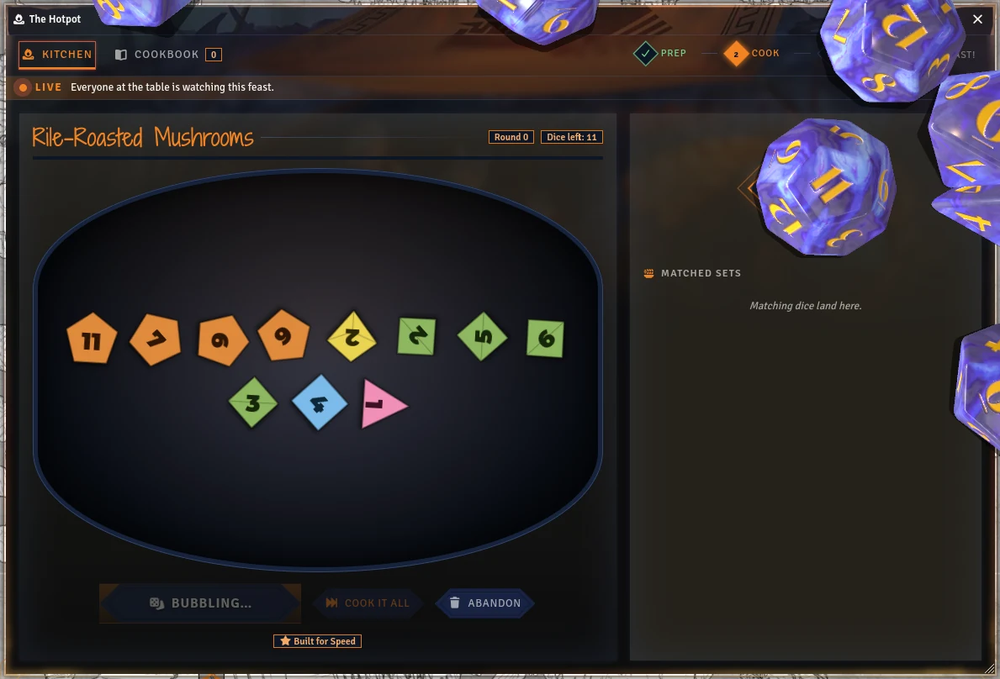 |
| **Cook:** the flavor dice wait on the stove. The whole table watches live. | Roll the pot. With Dice So Nice everyone sees the 3D dice. |
| 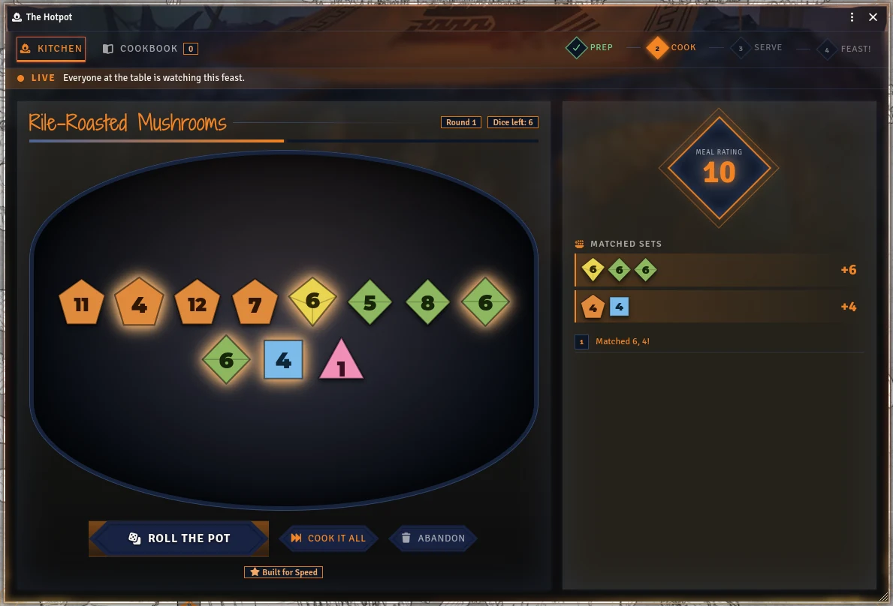 | 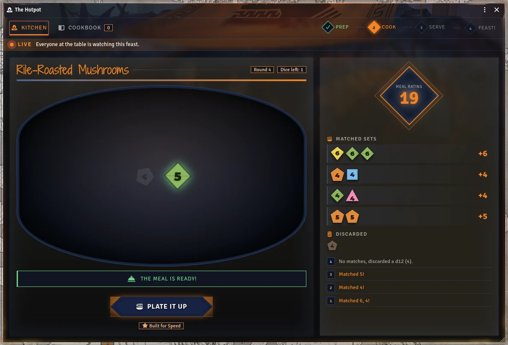 |
| Matching dice glow and move to the plate as sets. | One die left and the meal is done. Every set adds to the Meal Rating. |
| 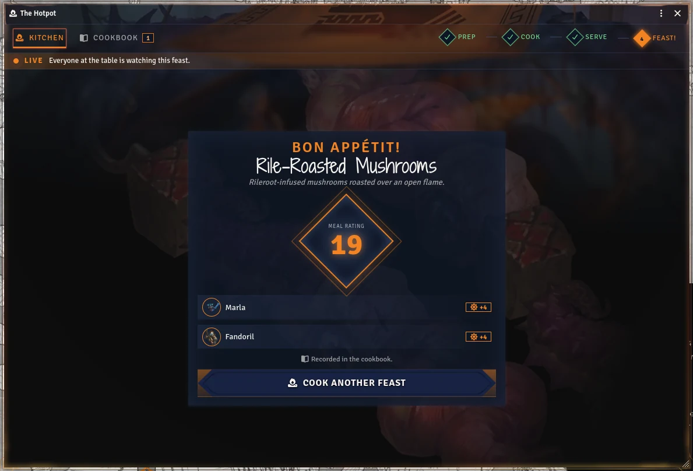 | 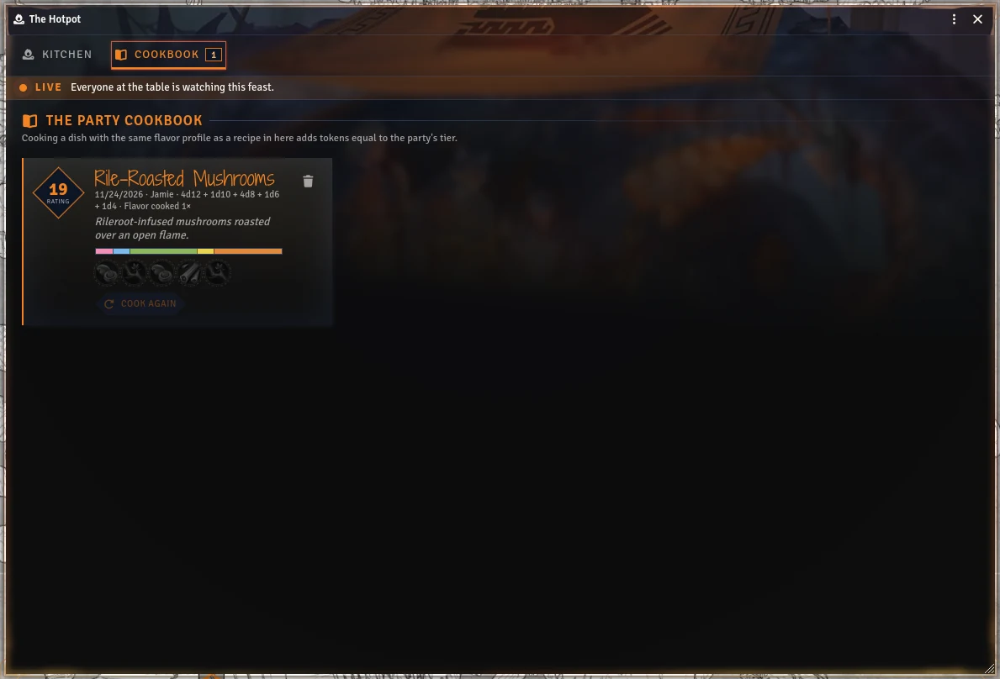 |
| **Serve:** each diner's share is applied to their sheet. | The dish goes into the party cookbook, ready to **Cook again**. |

## Features

### The kitchen

Open it with **Make a Feast** on the party sheet (next to the rest buttons), from the Daggerheart sidebar menu, or with the macro `game.modules.get('dh-hotpot').api.open()`.

1. **Prep:** the pantry shows every ingredient carried by the party and the party stash, with carry limits. Click or drag ingredients into the pot to see the flavor dice and flavor profile build up. Name the dish and pick who's eating.
2. **Cook:** roll the pot. Matching dice move to the plate as sets, and when nothing matches you choose a die (or a familiarity token) to discard. **Cook it all** plays out the rest.
3. **Serve:** every diner splits the full Meal Rating between clearing HP, clearing Stress and gaining Hope. **Serve!** applies it, records the recipe in the party cookbook and posts a chat card.

Rules covered:

- The flavor dice: Sweet d4, Salty d6, Bitter d8, Sour d10, Savory d12, Weird d20.
- Matched sets add up to the Meal Rating.
- Cooking a flavor profile that's already in the cookbook adds familiarity tokens equal to the party's tier.
- The special ingredient features: **Last Drop**, **Risky**, **Spicy** and **Built for Speed**.

### Cooking together

When the cook starts, or presses **Call everyone to the pot**, the kitchen opens for every connected player and mirrors the cook live: ingredients, rolls, matches and discards. Watchers are read-only, except that each player can adjust their own character's share while serving.

### Cookbook

Every dish the party cooks is recorded in the cookbook. **Cook again** refills the pot with the same ingredients if the party still carries them.

### Ingredient Generator (GM)

Open it from the **Beast Feast** section of the Daggerheart sidebar menu.

- **Beast:** pick an adversary. Its max HP sets how many ingredients it yields, and its tier steers the flavors. Hotpot's own adversaries yield their listed ingredients.
- **Bloom:** roll the Hope Die on the Gathering Blooms table.
- **Custom:** start from scratch.
- **Editing:** every result can be edited (flavors, name, property, image) and saved to a **larder**, which is a world compendium or an Items folder.
- **Handing out:** give servings to any character or the party stash with one click. Matching ingredients stack.

| | | |
|---|---|---|
| 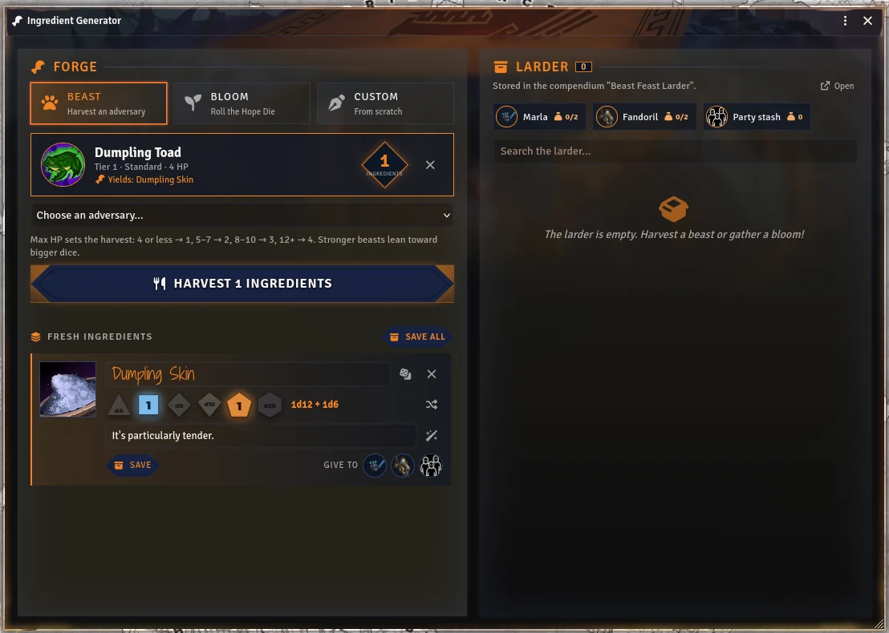 | 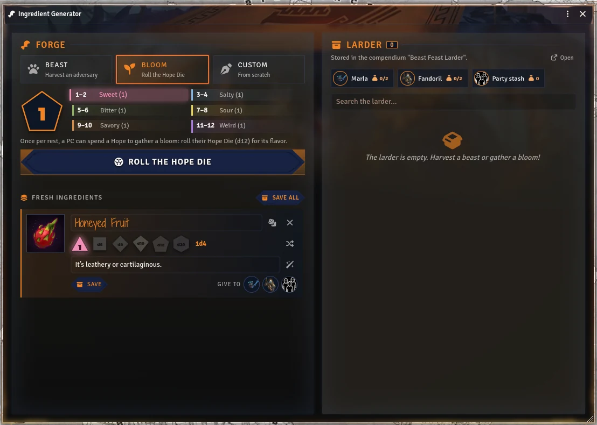 | 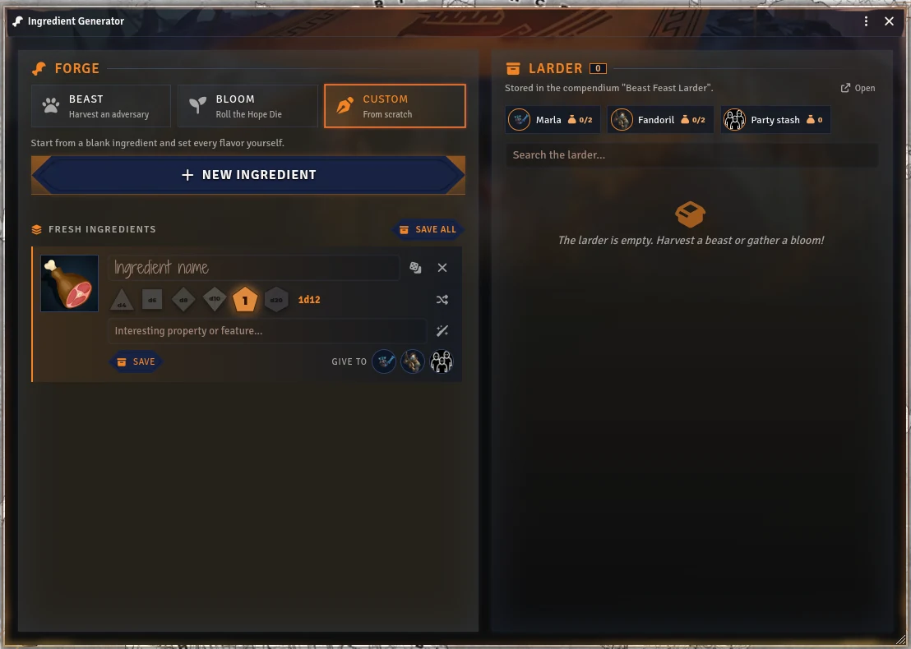 |
| **Beast:** a Dumpling Toad yields Dumpling Skin. | **Bloom:** a 1 on the Hope Die gives a Sweet bloom. | **Custom:** set every flavor yourself. |

### Beast Feast equipment

While the setting is on (the default):

- The compendium browser starts filtered to Beast Feast gear.
- Character creation suggests the closest Beast Feast weapons and armor instead of each class's standard gear.

### Compendiums

- **Beast Feast Adversaries:** 45 food-themed adversaries across Tiers 1–4 and every adversary type. Cave beasts like the Glutton Ogre and the Stew Sea Leviathan, fast-food foes like Fryling Swarms and the Supersize Hydra, and comfort-food creatures like Granny Gruel and the Mac and Cheese Colossus. Each lists what it yields when harvested.
- **Beast Feast Maps:** an adventure that imports the campaign map as a scene. It has pins for Elmore, the Plover Caves, the labeled regions and the four depths, plus a journal linking each pin to the matching Core Rulebook section. The map image is loaded from the Core Rulebook module.

## Settings

- **Kitchen theme:** follows the party sheet's Core Rulebook theme by default.
- **Roll flavor dice in 3D:** uses Dice So Nice when it's active.
- **Larder storage:** a world compendium or an Items folder.
- **Beast Feast equipment:** the compendium browser filter and the starting gear suggestions.
- **Hide rest buttons on character sheets** (on by default): in Beast Feast the party makes a feast instead of using rest downtime moves, so the short and long rest buttons are hidden.

Disabling the module puts all of these options back to their defaults. The party cookbooks are kept.

## Development

- `scripts/cooking.mjs` and `scripts/generator-rules.mjs` hold the rules with no Foundry dependencies.
- `data/adversaries.mjs` is the source for the adversary compendium. `tools/build-adversaries.mjs` rebuilds it inside a running world (see the file header).
- Releases are built by `.github/workflows/release.yml`. Publish a GitHub release tagged `vX.Y.Z`, and the workflow stamps the version and attaches `module.json` and `module.zip`.

## License

The Hotpot module (its code, templates, styles and original content) is released under the [MIT License](LICENSE). © 2026 emberite.

The MIT License doesn't cover Daggerheart material. Rules content used here falls under the notice below. The [Daggerheart Core Rulebook](https://www.foundryvtt.store/products/daggerheart-core) module's items, tables, art and map are loaded from that module at runtime and are not included in this repository.

This product includes materials from the
Daggerheart System Reference Document
2.0, © Critical Role, LLC. under the terms of
the Darrington Press Community Gaming
(DPCGL) License. More information can be
found at
https://www.daggerheart.com. There are
no previous modifications by others.
